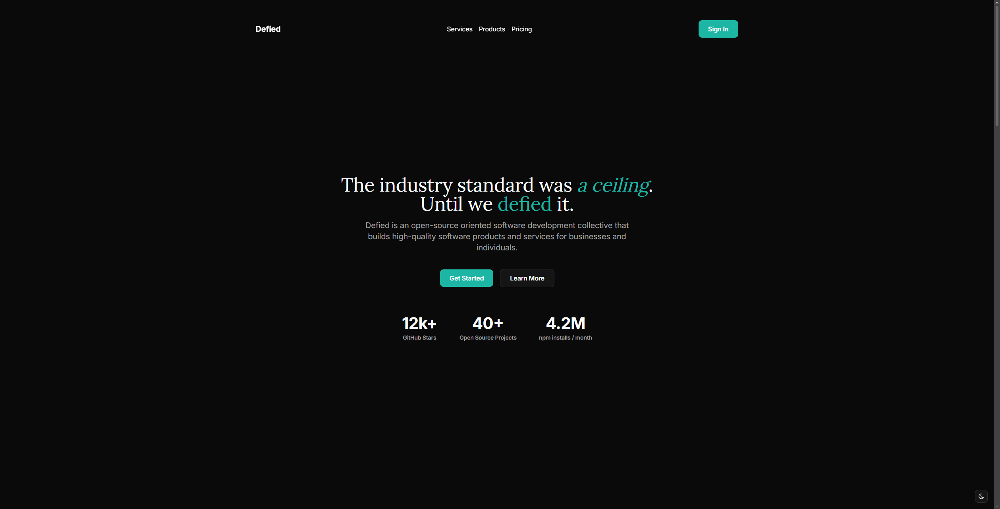

# Defied
An open-source oriented software development collective that builds high-quality software products and services for businesses and individuals.

## Defied website (The one that you find here)
The marketing site, blog and documentation hub for Defied, built as a Turborepo
monorepo with Next.js 16, NestJS, Prisma (MySQL), Auth.js and Fumadocs.



**Try it live:** [defied.dev](https://defied.dev)

---

## Features
- Landing page with WebGL hero animations
- Blog with a dashboard editor (BlockNote), syntax highlighting and LaTeX (KaTeX)
- Sign-in through Zitadel (OIDC) or an email magic link
- Fumadocs-powered documentation site with MDX support

---

## Repository layout

| Path               | What it is                                        | Dev port |
| ------------------ | ------------------------------------------------- | -------- |
| `apps/web`         | Next.js site: landing page, blog, dashboard       | 3001     |
| `apps/server`      | NestJS API: auth, blog, profile, health checks    | 3005     |
| `apps/docs`        | Fumadocs documentation site                       | 4001     |
| `packages/auth`    | Auth.js config (Zitadel + email), Stripe, mailer  |          |
| `packages/db`      | Prisma schema and client                          |          |
| `packages/env`     | Zod-validated environment variables               |          |
| `packages/config`  | Shared TypeScript config                          |          |
| `packages/content` | Shared content                                    |          |

---

## How to run the project locally

### Prerequisites
- Node.js 22 (`>=22 <23`)
- pnpm 11 (`corepack enable` picks up the pinned version)
- A MySQL database
- A Zitadel application (OIDC client ID and secret) for sign-in
- SMTP credentials for magic-link emails (e.g. [Ethereal](https://ethereal.email) in development)

### Steps
1. Clone the repository and install dependencies:
   ```bash
   git clone https://github.com/defied-labs/website.git
   cd website
   pnpm install
   ```
2. Create the env files from the examples and fill in real values:
   ```bash
   cp apps/server/.env.example apps/server/.env
   cp apps/web/.env.example apps/web/.env
   cp apps/docs/.env.example apps/docs/.env
   cp packages/db/.env.example packages/db/.env
   ```
   `DATABASE_URL` must match in `apps/server/.env` and `packages/db/.env`.
   `AUTH_SECRET` must be at least 32 characters (`openssl rand -base64 32`).
3. Generate the Prisma client and create the database schema:
   ```bash
   pnpm db:generate
   pnpm db:push
   ```
4. Start everything:
   ```bash
   pnpm dev
   ```
   Or a single app with `pnpm dev:web`, `pnpm dev:server` or `pnpm dev:docs`.
   Check the server with `curl http://localhost:3005/health`.

### Quality checks
These are the same checks CI runs on every push and pull request:
```bash
pnpm validate       # workspace manifest checks
pnpm lint           # Biome
pnpm check-types    # TypeScript in every package
pnpm test           # Vitest unit tests
pnpm test:e2e       # Playwright smoke test (builds the web app first)
```

## Environment configuration

Each app and package has an `.env.example` that documents its contract. Copy the
example into the relevant workspace directory and keep secrets out of git.

The server and web app support `APP_ENV=development`, `staging`, or `production`.
They load `.env.<APP_ENV>` first and then `.env` (the web app also checks
`.env.local`). Missing required values fail startup or build with a validation
error; there are no production fallbacks for secrets, URLs, or database targets.

The Nest server logs the selected environment and non-secret provider endpoints at
startup. Its anonymous operational checks are available at `/health`,
`/health/db`, `/health/auth`, and `/health/mail`.

## How it works
The landing page uses WebGL for interactive 3D graphics. Blog posts are written in
the dashboard with BlockNote, stored as JSON through the NestJS API, and rendered
to sanitized HTML with Shiki/Prism highlighting and KaTeX math. Authentication
runs through Auth.js with a Prisma adapter, so sessions live in the database.
The documentation site is powered by Fumadocs.

## Credits
- [Next.js](https://nextjs.org/)
- [NestJS](https://nestjs.com/)
- [Prisma](https://www.prisma.io/)
- [Auth.js](https://authjs.dev/)
- [BlockNote](https://www.blocknotejs.org/)
- [Fumadocs](https://fumadocs.com/)
- [Biome](https://biomejs.dev/)
